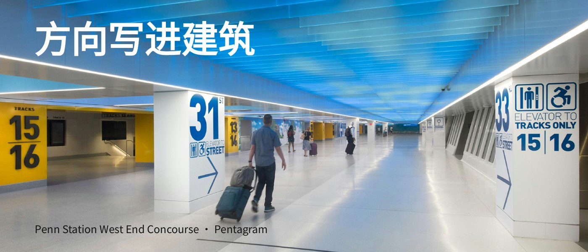

# L002 全幅场景与自然阅读区

源版本：45 · 家族：F02 · 类型：reference · 条目版本：0.2

## 结构特征

宽幅真实场景占全画面；上方短标题与底部来源利用照片中的安全区域。

## 构图关系

真实透视占据全幅，标题利用非证据区域，阅读路径与场景方向联系

## 适用内容

观察空间、环境与真实观看路径

## 输入条件

一张适用的宽幅场景；短标题与稳定来源区

## 适配规则

先列入口、标识等必见局部，再根据真实图片选文字区；可改独立阅读带

## 不适用情况

没有安全文字区且必要证据密集；窄图无法保全观察范围

## 邻页安排

L002与L006共用全幅图像骨架；不能按照片题材分成两类结构

## 搭配建议

{
  "before": "L001｜先提问再进入现场；L010｜短句之后用场景展开。",
  "after": "L003｜从环境切向具体对象；避免连续两张同透视照片。",
  "avoid": "L002与L006共用全幅图像骨架；不能按照片题材分成两类结构"
}

## 结构字段

{
  "skeleton": "fullbleed",
  "alignment": [
    "top-left",
    "bottom-left"
  ],
  "reading": [
    "scene-depth",
    "title-to-image"
  ],
  "whitespace": [
    "photo-negative-space"
  ],
  "relations": [
    "text-in-photo",
    "evidence-protected"
  ],
  "regions": [
    {
      "kind": "image",
      "rect": [
        0,
        0,
        1,
        1
      ]
    },
    {
      "kind": "text",
      "rect": [
        0.05878,
        0.0625,
        0.88542,
        0.21875
      ]
    },
    {
      "kind": "text",
      "rect": [
        0.05952,
        0.88368,
        0.84077,
        0.07292
      ]
    }
  ],
  "basis": "原样预览分析＋源PPT对象框；对象框不等于字形实测"
}

## 选版提示词

仅当本页任务适合「观察空间、环境与真实观看路径」，且满足「一张适用的宽幅场景；短标题与稳定来源区」时，将L002列为候选。查看原图及来源第2页后判断。没有安全文字区且必要证据密集；窄图无法保全观察范围时排除。

## 制作提示词

参考L002「全幅场景与自然阅读区」，用下面的当前输入制作页面：
页面目的：{页面目的}
标题与正文：{当前文案}
图片／数据：{当前素材及其来源}
前后页：{邻页说明}

保留关系：宽幅真实场景占全画面；上方短标题与底部来源利用照片中的安全区域。
适配指令：按当前照片标出入口、标识、人物等必要证据；安全文字区不足则另设阅读带或换图，不能照搬标题位置。
输入条件：一张适用的宽幅场景；短标题与稳定来源区
邻页检查：L002与L006共用全幅图像骨架；不能按照片题材分成两类结构

按当前任务制作21:9黑色或近黑PPT。保留原生可编辑文字；图片等比，不覆盖必要证据。使用当前真实文案和素材，参考页照片、模拟数据与备注不自动成为新任务内容。完成后渲染审核本页与邻页，检查字形、主体、对比度、比例、路径和原生备注。缺乏适配条件时改选版式或重新设计。

## 来源

未记录

## 验证状态

结构指令已编写，尚未用新内容试排验证

构图参考不等于可编辑模板；换图换字后须重新适配。反例不参与选版。
