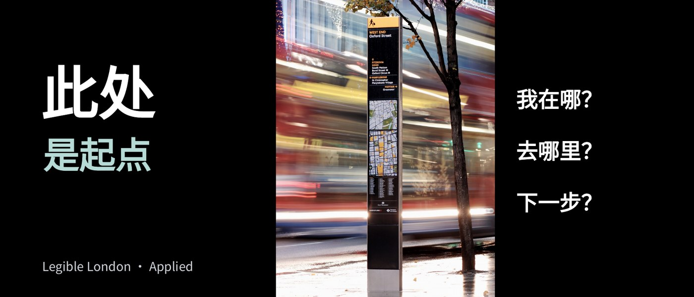

# L003 竖幅主体与两侧邻接文字

源版本：44 · 家族：F03 · 类型：reference · 条目版本：0.2

## 结构特征

中央竖幅图片贯穿纵向；左侧大字组与右侧短问题以不同体量邻接。

## 构图关系

竖图居中形成主轴，左侧字组与右侧问题以不同体量建立两侧关系

## 适用内容

竖向作品、标识或人物及少量观察问题

## 输入条件

一张竖图；左侧主题，右侧若干短问题

## 适配规则

依据原图比例调整图幅和文字列宽，不拉宽图片；必要证据完整保留

## 不适用情况

要求展示标识全貌或底座而当前原图已缺失；长段落或多图对照

## 邻页安排

与其他邻接结构比较实际占幅，镜像只作为变体；本源图不展示完整底座

## 搭配建议

{
  "before": "L002｜由全景进入对象；L001｜从概念转向观察。",
  "after": "L004｜把观察转为步骤；L008｜引出同尺度对照。",
  "avoid": "与其他邻接结构比较实际占幅，镜像只作为变体；本源图不展示完整底座"
}

## 结构字段

{
  "skeleton": "triptych-portrait",
  "alignment": [
    "left",
    "center",
    "right"
  ],
  "reading": [
    "left-to-center-to-right"
  ],
  "whitespace": [
    "side-negative-space"
  ],
  "relations": [
    "portrait-between-text",
    "adjacency"
  ],
  "regions": [
    {
      "kind": "image",
      "rect": [
        0.39807,
        0,
        0.31473,
        1
      ]
    },
    {
      "kind": "text",
      "rect": [
        0.05952,
        0.19097,
        0.32738,
        0.23264
      ]
    },
    {
      "kind": "text",
      "rect": [
        0.0625,
        0.44444,
        0.33036,
        0.16493
      ]
    },
    {
      "kind": "text",
      "rect": [
        0.74405,
        0.28819,
        0.20312,
        0.10069
      ]
    },
    {
      "kind": "text",
      "rect": [
        0.74405,
        0.46181,
        0.20312,
        0.10069
      ]
    },
    {
      "kind": "text",
      "rect": [
        0.74405,
        0.63542,
        0.20312,
        0.10069
      ]
    },
    {
      "kind": "text",
      "rect": [
        0.06101,
        0.87153,
        0.32589,
        0.07812
      ]
    }
  ],
  "basis": "原样预览分析＋源PPT对象框；对象框不等于字形实测"
}

## 选版提示词

仅当本页任务适合「竖向作品、标识或人物及少量观察问题」，且满足「一张竖图；左侧主题，右侧若干短问题」时，将L003列为候选。查看原图及来源第3页后判断。要求展示标识全貌或底座而当前原图已缺失；长段落或多图对照时排除。

## 制作提示词

参考L003「竖幅主体与两侧邻接文字」，用下面的当前输入制作页面：
页面目的：{页面目的}
标题与正文：{当前文案}
图片／数据：{当前素材及其来源}
前后页：{邻页说明}

保留关系：中央竖幅图片贯穿纵向；左侧大字组与右侧短问题以不同体量邻接。
适配指令：保持竖图原比例；依主体宽度调整两侧列宽；照片原本缺失的底座和边缘不得虚构补齐为证据。
输入条件：一张竖图；左侧主题，右侧若干短问题
邻页检查：与其他邻接结构比较实际占幅，镜像只作为变体；本源图不展示完整底座

按当前任务制作21:9黑色或近黑PPT。保留原生可编辑文字；图片等比，不覆盖必要证据。使用当前真实文案和素材，参考页照片、模拟数据与备注不自动成为新任务内容。完成后渲染审核本页与邻页，检查字形、主体、对比度、比例、路径和原生备注。缺乏适配条件时改选版式或重新设计。

## 来源

未记录

## 验证状态

结构指令已编写，尚未用新内容试排验证

构图参考不等于可编辑模板；换图换字后须重新适配。反例不参与选版。
