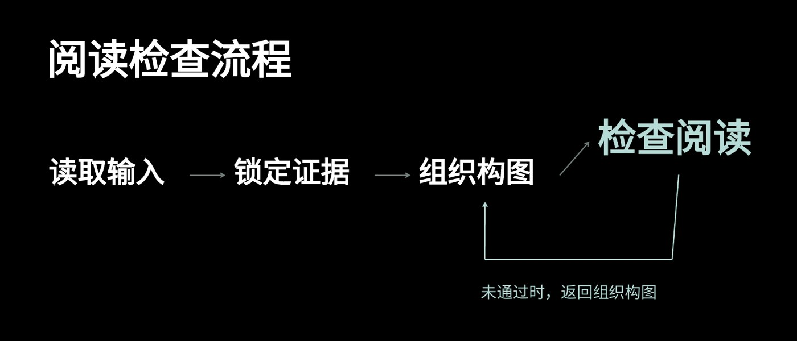

# L004 主路径与独立反馈通道

源版本：46 · 家族：F04 · 类型：reference · 条目版本：0.2

## 结构特征

横向主路径逐步推进；反馈从末端沿下方独立通道返回对应步骤。

## 构图关系

主路径横向推进，末端节点前显；反馈在独立下方通道返回对应节点

## 适用内容

顺序步骤及真实存在的返工或反馈关系

## 输入条件

原生步骤、文字与连线；不需要装饰照片

## 适配规则

步骤名称、数量、方向与反馈依据先确定，再调节点间距和文字位置

## 不适用情况

没有真实反馈关系却为了视觉张力增加回路；复杂网络强塞四步

## 邻页安排

可与水平路径或偏置递进比较；必要连续揭示可保骨架并说明推进

## 搭配建议

{
  "before": "L003｜由观察问题转为操作；L005｜解释后给出路径。",
  "after": "L008｜展示步骤应用前后差异；L010｜以结论结束。",
  "avoid": "可与水平路径或偏置递进比较；必要连续揭示可保骨架并说明推进"
}

## 结构字段

{
  "skeleton": "process-feedback",
  "alignment": [
    "left",
    "horizontal",
    "bottom"
  ],
  "reading": [
    "left-to-right",
    "return-loop"
  ],
  "whitespace": [
    "lower-feedback-lane"
  ],
  "relations": [
    "sequential-nodes",
    "feedback-edge"
  ],
  "regions": [
    {
      "kind": "connector",
      "rect": [
        0.60826,
        0.59201,
        0.00037,
        0.1684
      ]
    },
    {
      "kind": "connector",
      "rect": [
        0.60863,
        0.76128,
        0.23438,
        0
      ]
    },
    {
      "kind": "connector",
      "rect": [
        0.84338,
        0.51215,
        0.00818,
        0.24826
      ]
    },
    {
      "kind": "connector",
      "rect": [
        0.70238,
        0.41493,
        0.0372,
        0.09896
      ]
    },
    {
      "kind": "connector",
      "rect": [
        0.47024,
        0.51389,
        0.04464,
        0
      ]
    },
    {
      "kind": "connector",
      "rect": [
        0.2381,
        0.51389,
        0.04464,
        0
      ]
    },
    {
      "kind": "text",
      "rect": [
        0.05878,
        0.09722,
        0.81845,
        0.17188
      ]
    },
    {
      "kind": "text",
      "rect": [
        0.06101,
        0.44965,
        0.16667,
        0.12847
      ]
    },
    {
      "kind": "shape",
      "rect": [
        0.0506,
        0.43576,
        0.1875,
        0.15625
      ]
    },
    {
      "kind": "text",
      "rect": [
        0.29315,
        0.44965,
        0.16667,
        0.12847
      ]
    },
    {
      "kind": "shape",
      "rect": [
        0.28274,
        0.43576,
        0.1875,
        0.15625
      ]
    },
    {
      "kind": "text",
      "rect": [
        0.5253,
        0.44965,
        0.16667,
        0.12847
      ]
    },
    {
      "kind": "shape",
      "rect": [
        0.51488,
        0.43576,
        0.1875,
        0.15625
      ]
    },
    {
      "kind": "text",
      "rect": [
        0.75,
        0.3316,
        0.20312,
        0.16667
      ]
    },
    {
      "kind": "shape",
      "rect": [
        0.73958,
        0.31771,
        0.22396,
        0.19444
      ]
    },
    {
      "kind": "shape",
      "rect": [
        0.84301,
        0.76042,
        0.00074,
        0.00174
      ]
    },
    {
      "kind": "shape",
      "rect": [
        0.60789,
        0.76042,
        0.00074,
        0.00174
      ]
    },
    {
      "kind": "text",
      "rect": [
        0.60342,
        0.82812,
        0.3497,
        0.07639
      ]
    }
  ],
  "basis": "原样预览分析＋源PPT对象框；对象框不等于字形实测"
}

## 选版提示词

仅当本页任务适合「顺序步骤及真实存在的返工或反馈关系」，且满足「原生步骤、文字与连线；不需要装饰照片」时，将L004列为候选。查看原图及来源第4页后判断。没有真实反馈关系却为了视觉张力增加回路；复杂网络强塞四步时排除。

## 制作提示词

参考L004「主路径与独立反馈通道」，用下面的当前输入制作页面：
页面目的：{页面目的}
标题与正文：{当前文案}
图片／数据：{当前素材及其来源}
前后页：{邻页说明}

保留关系：横向主路径逐步推进；反馈从末端沿下方独立通道返回对应步骤。
适配指令：先核实步骤、方向与真实反馈，再排节点和连线；不为构图凭空增加回路；使用原生可编辑连接线。
输入条件：原生步骤、文字与连线；不需要装饰照片
邻页检查：可与水平路径或偏置递进比较；必要连续揭示可保骨架并说明推进

按当前任务制作21:9黑色或近黑PPT。保留原生可编辑文字；图片等比，不覆盖必要证据。使用当前真实文案和素材，参考页照片、模拟数据与备注不自动成为新任务内容。完成后渲染审核本页与邻页，检查字形、主体、对比度、比例、路径和原生备注。缺乏适配条件时改选版式或重新设计。

## 来源

未记录

## 验证状态

结构指令已编写，尚未用新内容试排验证

## 原件可用性

{
  "availability": "not-mirrored",
  "requires_auth": true,
  "animated": false,
  "public_url": null
}

构图参考不等于可编辑模板；换图换字后须重新适配。反例不参与选版。
