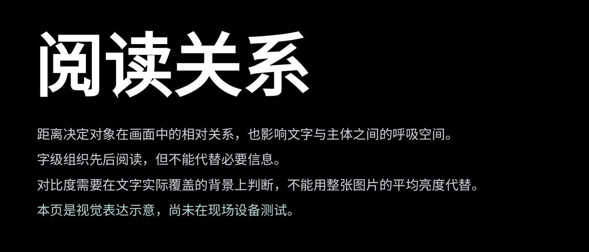

# L005 大主题与开放阅读带

源版本：48 · 家族：F05 · 类型：reference · 条目版本：0.2

## 结构特征

左上大主题作为入口；下方开放的阅读行逐级解释，依靠字号和行距组织。

## 构图关系

主题字组占上部，完整解释在下方开放排列，以体量和间距组织阅读

## 适用内容

完整判断及若干解释或限定

## 输入条件

无图片；一个主题与有层级的阅读行

## 适配规则

保留全文和限定；按实际字体、行长及显示距离重排，不按固定字符数硬套

## 不适用情况

全文超出可读容量；需要观察真实作品但用文字替代图片

## 邻页安排

与L001和L010分别承担解释、引入和收束，避免连续同位置大标题

## 搭配建议

{
  "before": "L001｜先提出短判断；L002｜观察案例后进入解释。",
  "after": "L004｜解释转操作；L007｜以数据支撑解释；避免同位置连续大标题。",
  "avoid": "与L001和L010分别承担解释、引入和收束，避免连续同位置大标题"
}

## 结构字段

{
  "skeleton": "headline-reading-band",
  "alignment": [
    "top-left",
    "left"
  ],
  "reading": [
    "top-to-bottom"
  ],
  "whitespace": [
    "right-open",
    "lower-open"
  ],
  "relations": [
    "headline-over-lines",
    "type-hierarchy"
  ],
  "regions": [
    {
      "kind": "text",
      "rect": [
        0.05952,
        0.08333,
        0.87798,
        0.33854
      ]
    },
    {
      "kind": "text",
      "rect": [
        0.0625,
        0.5,
        0.88542,
        0.08333
      ]
    },
    {
      "kind": "text",
      "rect": [
        0.0625,
        0.60069,
        0.88542,
        0.08333
      ]
    },
    {
      "kind": "text",
      "rect": [
        0.0625,
        0.70139,
        0.88542,
        0.08333
      ]
    },
    {
      "kind": "text",
      "rect": [
        0.0625,
        0.80208,
        0.88542,
        0.08333
      ]
    }
  ],
  "basis": "原样预览分析＋源PPT对象框；对象框不等于字形实测"
}

## 选版提示词

仅当本页任务适合「完整判断及若干解释或限定」，且满足「无图片；一个主题与有层级的阅读行」时，将L005列为候选。查看原图及来源第5页后判断。全文超出可读容量；需要观察真实作品但用文字替代图片时排除。

## 制作提示词

参考L005「大主题与开放阅读带」，用下面的当前输入制作页面：
页面目的：{页面目的}
标题与正文：{当前文案}
图片／数据：{当前素材及其来源}
前后页：{邻页说明}

保留关系：左上大主题作为入口；下方开放的阅读行逐级解释，依靠字号和行距组织。
适配指令：保留全文及条件，用语义分段、行长、字号和间距适配；文本过载时分成内容有推进的页面，不删除限定条件。
输入条件：无图片；一个主题与有层级的阅读行
邻页检查：与L001和L010分别承担解释、引入和收束，避免连续同位置大标题

按当前任务制作21:9黑色或近黑PPT。保留原生可编辑文字；图片等比，不覆盖必要证据。使用当前真实文案和素材，参考页照片、模拟数据与备注不自动成为新任务内容。完成后渲染审核本页与邻页，检查字形、主体、对比度、比例、路径和原生备注。缺乏适配条件时改选版式或重新设计。

## 来源

未记录

## 验证状态

结构指令已编写，尚未用新内容试排验证

## 原件可用性

{
  "availability": "not-mirrored",
  "requires_auth": true,
  "animated": false,
  "public_url": null
}

构图参考不等于可编辑模板；换图换字后须重新适配。反例不参与选版。
