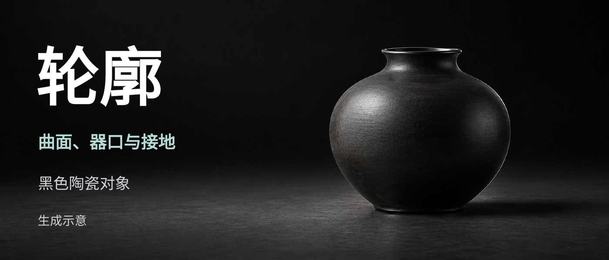

# L006 黑色对象与轮廓空间

源版本：46 · 家族：F02 · 类型：reference · 条目版本：0.2

## 结构特征

对象位于右侧，左侧暗部承载字组；器口、曲面与接地关系形成空间层次。

## 构图关系

对象在右侧承担主角，文字在左侧暗部；曲面与接触关系建立空间

## 适用内容

展示轮廓、材料明暗或接地关系

## 输入条件

一张有足够轮廓与空间的对象图；少量邻接文字

## 适配规则

保原比例与任务所需边缘，黑主体融底时调整取景或换图，不能只加辉光

## 不适用情况

用生成图冒充真实作品；必要轮廓缺失或光影不可信

## 邻页安排

与L002归同一全幅图像家族，只是主角与文字承载条件不同

## 搭配建议

{
  "before": "L001｜先给概念；L005｜先解释观察维度。",
  "after": "L008｜进行同尺度对照；L010｜收束视觉判断；不与L002按不同家族计数。",
  "avoid": "与L002归同一全幅图像家族，只是主角与文字承载条件不同"
}

## 结构字段

{
  "skeleton": "fullbleed",
  "alignment": [
    "top-left",
    "bottom-left"
  ],
  "reading": [
    "title-to-image",
    "left-to-right"
  ],
  "whitespace": [
    "photo-negative-space"
  ],
  "relations": [
    "text-in-photo",
    "contour-space"
  ],
  "regions": [
    {
      "kind": "image",
      "rect": [
        0,
        0,
        1,
        1
      ]
    },
    {
      "kind": "text",
      "rect": [
        0.05952,
        0.14062,
        0.44271,
        0.30035
      ]
    },
    {
      "kind": "text",
      "rect": [
        0.0625,
        0.50347,
        0.39807,
        0.09201
      ]
    },
    {
      "kind": "text",
      "rect": [
        0.0625,
        0.6684,
        0.42411,
        0.09201
      ]
    },
    {
      "kind": "text",
      "rect": [
        0.0625,
        0.81944,
        0.43155,
        0.07465
      ]
    }
  ],
  "basis": "原样预览分析＋源PPT对象框；对象框不等于字形实测"
}

## 选版提示词

仅当本页任务适合「展示轮廓、材料明暗或接地关系」，且满足「一张有足够轮廓与空间的对象图；少量邻接文字」时，将L006列为候选。查看原图及来源第6页后判断。用生成图冒充真实作品；必要轮廓缺失或光影不可信时排除。

## 制作提示词

参考L006「黑色对象与轮廓空间」，用下面的当前输入制作页面：
页面目的：{页面目的}
标题与正文：{当前文案}
图片／数据：{当前素材及其来源}
前后页：{邻页说明}

保留关系：对象位于右侧，左侧暗部承载字组；器口、曲面与接地关系形成空间层次。
适配指令：优先选择具备清晰轮廓和可信接地关系的图片；图片等比、必要边缘完整；黑主体融底时换图或调整取景，生成示意必须标注。
输入条件：一张有足够轮廓与空间的对象图；少量邻接文字
邻页检查：与L002归同一全幅图像家族，只是主角与文字承载条件不同

按当前任务制作21:9黑色或近黑PPT。保留原生可编辑文字；图片等比，不覆盖必要证据。使用当前真实文案和素材，参考页照片、模拟数据与备注不自动成为新任务内容。完成后渲染审核本页与邻页，检查字形、主体、对比度、比例、路径和原生备注。缺乏适配条件时改选版式或重新设计。

## 来源

未记录

## 验证状态

结构指令已编写，尚未用新内容试排验证

## 原件可用性

{
  "availability": "not-mirrored",
  "requires_auth": true,
  "animated": false,
  "public_url": null
}

构图参考不等于可编辑模板；换图换字后须重新适配。反例不参与选版。
