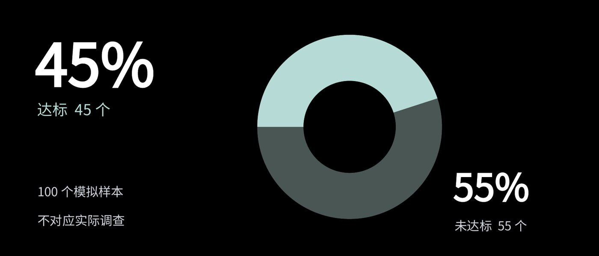

# L007 比例图形与两侧数字字组

源版本：47 · 家族：F06 · 类型：reference · 条目版本：0.2

## 结构特征

中央比例图形与两侧数字形成三方关系；数字、类别和分母邻接。

## 构图关系

比例图形占中部，数字与对应类别在两侧形成关系，分母和声明邻接

## 适用内容

少量类别的真实比例及分母说明

## 输入条件

原生图表与可编辑标签；示例为45/55模拟比例

## 适配规则

换数据同步更新图形、标签、单位与分母；环形与比例条可同输入比较

## 不适用情况

类别太多、标签过长或图形不能支持当前比较任务

## 邻页安排

不因换成其他图表颜色就计新版式；连续同口径比较可保持结构

## 搭配建议

{
  "before": "L005｜解释后呈现证据；L001｜先提出数量问题。",
  "after": "L008｜进入比较；L010｜提炼结论；同口径连续比较可保留骨架。",
  "avoid": "不因换成其他图表颜色就计新版式；连续同口径比较可保持结构"
}

## 结构字段

{
  "skeleton": "chart-flanked",
  "alignment": [
    "left",
    "center",
    "right"
  ],
  "reading": [
    "left-to-center-to-right"
  ],
  "whitespace": [
    "chart-surround"
  ],
  "relations": [
    "proportional-chart",
    "flanking-numbers"
  ],
  "regions": [
    {
      "kind": "text",
      "rect": [
        0.05878,
        0.10764,
        0.3125,
        0.26562
      ]
    },
    {
      "kind": "text",
      "rect": [
        0.0625,
        0.39236,
        0.30134,
        0.08507
      ]
    },
    {
      "kind": "text",
      "rect": [
        0.7567,
        0.63889,
        0.2128,
        0.19271
      ]
    },
    {
      "kind": "text",
      "rect": [
        0.75893,
        0.85243,
        0.19345,
        0.07465
      ]
    },
    {
      "kind": "text",
      "rect": [
        0.0625,
        0.71875,
        0.31324,
        0.07465
      ]
    },
    {
      "kind": "text",
      "rect": [
        0.0625,
        0.8316,
        0.31324,
        0.07465
      ]
    },
    {
      "kind": "chart",
      "rect": [
        0.36458,
        0.11285,
        0.43824,
        0.76562
      ]
    }
  ],
  "basis": "原样预览分析＋源PPT对象框；对象框不等于字形实测"
}

## 选版提示词

仅当本页任务适合「少量类别的真实比例及分母说明」，且满足「原生图表与可编辑标签；示例为45/55模拟比例」时，将L007列为候选。查看原图及来源第7页后判断。类别太多、标签过长或图形不能支持当前比较任务时排除。

## 制作提示词

参考L007「比例图形与两侧数字字组」，用下面的当前输入制作页面：
页面目的：{页面目的}
标题与正文：{当前文案}
图片／数据：{当前素材及其来源}
前后页：{邻页说明}

保留关系：中央比例图形与两侧数字形成三方关系；数字、类别和分母邻接。
适配指令：仅用当前有依据的数据；同步更新图形、数值、类别、单位和分母；原生可编辑图表，不继承示例45/55为真实结论。
输入条件：原生图表与可编辑标签；示例为45/55模拟比例
邻页检查：不因换成其他图表颜色就计新版式；连续同口径比较可保持结构

按当前任务制作21:9黑色或近黑PPT。保留原生可编辑文字；图片等比，不覆盖必要证据。使用当前真实文案和素材，参考页照片、模拟数据与备注不自动成为新任务内容。完成后渲染审核本页与邻页，检查字形、主体、对比度、比例、路径和原生备注。缺乏适配条件时改选版式或重新设计。

## 来源

未记录

## 验证状态

结构指令已编写，尚未用新内容试排验证

## 原件可用性

{
  "availability": "not-mirrored",
  "requires_auth": true,
  "animated": false,
  "public_url": null
}

构图参考不等于可编辑模板；换图换字后须重新适配。反例不参与选版。
