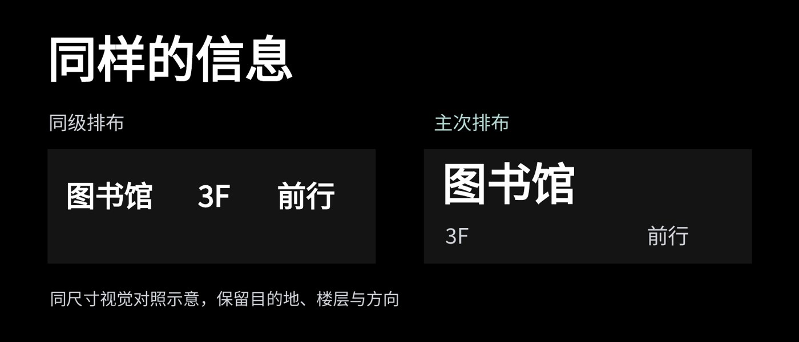

# L008 同尺度对象的层级对照

源版本：47 · 家族：F07 · 类型：reference · 条目版本：0.2

## 结构特征

两个同尺度对象在同一基线上并置；差异由内部信息层级呈现。

## 构图关系

同基线并置对象，使字级、位置与读序差异可以直接观察

## 适用内容

比较同一信息在不同层级组织下的阅读差异

## 输入条件

两个同尺度对象；比较标签与必要说明

## 适配规则

保持比较对象尺度、口径和必需信息；对象外框为比较证据，不是全套内容卡片

## 不适用情况

任意放大其中一侧制造差异；比较条件不一致

## 邻页安排

必要连续比较保持基线并记录推进，不能将两个矩形套到所有内容页

## 搭配建议

{
  "before": "L003｜由单对象观察进入比较；L004｜流程后展示效果。",
  "after": "L005｜解释造成差异的机制；L010｜提炼判断。",
  "avoid": "必要连续比较保持基线并记录推进，不能将两个矩形套到所有内容页"
}

## 结构字段

{
  "skeleton": "equal-comparison",
  "alignment": [
    "top-left",
    "horizontal",
    "baseline"
  ],
  "reading": [
    "left-to-right",
    "parallel"
  ],
  "whitespace": [
    "between-equal-objects"
  ],
  "relations": [
    "equal-scale-pair",
    "controlled-comparison"
  ],
  "regions": [
    {
      "kind": "text",
      "rect": [
        0.05952,
        0.0816,
        0.49851,
        0.19618
      ]
    },
    {
      "kind": "text",
      "rect": [
        0.06101,
        0.32465,
        0.41518,
        0.08681
      ]
    },
    {
      "kind": "text",
      "rect": [
        0.54315,
        0.32465,
        0.41667,
        0.08681
      ]
    },
    {
      "kind": "shape",
      "rect": [
        0.05952,
        0.43576,
        0.41071,
        0.33507
      ]
    },
    {
      "kind": "shape",
      "rect": [
        0.53051,
        0.43576,
        0.41071,
        0.33507
      ]
    },
    {
      "kind": "text",
      "rect": [
        0.08259,
        0.5191,
        0.14881,
        0.11111
      ]
    },
    {
      "kind": "text",
      "rect": [
        0.24777,
        0.5191,
        0.07589,
        0.11111
      ]
    },
    {
      "kind": "text",
      "rect": [
        0.34673,
        0.5191,
        0.11161,
        0.11111
      ]
    },
    {
      "kind": "text",
      "rect": [
        0.55357,
        0.45486,
        0.32515,
        0.17882
      ]
    },
    {
      "kind": "text",
      "rect": [
        0.55729,
        0.65104,
        0.14509,
        0.09549
      ]
    },
    {
      "kind": "text",
      "rect": [
        0.80952,
        0.65104,
        0.10863,
        0.09549
      ]
    },
    {
      "kind": "text",
      "rect": [
        0.0625,
        0.84375,
        0.88542,
        0.0816
      ]
    }
  ],
  "basis": "原样预览分析＋源PPT对象框；对象框不等于字形实测"
}

## 选版提示词

仅当本页任务适合「比较同一信息在不同层级组织下的阅读差异」，且满足「两个同尺度对象；比较标签与必要说明」时，将L008列为候选。查看原图及来源第8页后判断。任意放大其中一侧制造差异；比较条件不一致时排除。

## 制作提示词

参考L008「同尺度对象的层级对照」，用下面的当前输入制作页面：
页面目的：{页面目的}
标题与正文：{当前文案}
图片／数据：{当前素材及其来源}
前后页：{邻页说明}

保留关系：两个同尺度对象在同一基线上并置；差异由内部信息层级呈现。
适配指令：保持尺度、信息口径和比较条件一致；外框属于被比较对象，不将全套内容都改成两张卡片；不任意放大一侧制造优势。
输入条件：两个同尺度对象；比较标签与必要说明
邻页检查：必要连续比较保持基线并记录推进，不能将两个矩形套到所有内容页

按当前任务制作21:9黑色或近黑PPT。保留原生可编辑文字；图片等比，不覆盖必要证据。使用当前真实文案和素材，参考页照片、模拟数据与备注不自动成为新任务内容。完成后渲染审核本页与邻页，检查字形、主体、对比度、比例、路径和原生备注。缺乏适配条件时改选版式或重新设计。

## 来源

未记录

## 验证状态

结构指令已编写，尚未用新内容试排验证

## 原件可用性

{
  "availability": "not-mirrored",
  "requires_auth": true,
  "animated": false,
  "public_url": null
}

构图参考不等于可编辑模板；换图换字后须重新适配。反例不参与选版。
