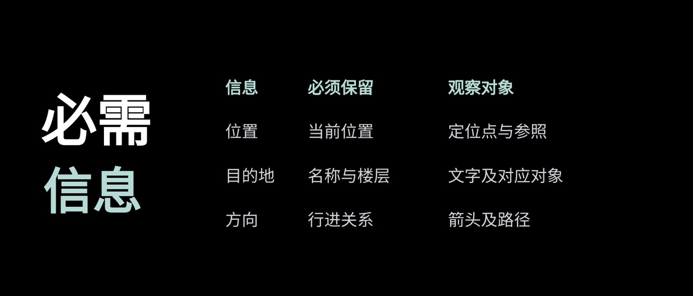

# L009 主题字组与开放表格

源版本：48 · 家族：F08 · 类型：reference · 条目版本：0.2

## 结构特征

左侧主题字组与右侧开放表格并置；表头和行列支撑稳定查阅。

## 构图关系

主题靠左形成前层，表头与开放行列在右侧组织查阅路径

## 适用内容

若干同口径项目与属性的稳定查阅

## 输入条件

原生表格；一个主题字组与完整行列

## 适配规则

随实际行列和最长单元格调整列宽行高，不删条件，不把小表孤立在大画布

## 不适用情况

行列过密、精读任务超出显示条件，或关系本应画成流程

## 邻页安排

稳定表头可保留，实际比较任务相同的连续页不强迫跳换结构

## 搭配建议

{
  "before": "L005｜概念解释后整理属性；L004｜步骤说明后提供核对表。",
  "after": "L003｜选取一项展开观察；L010｜结束查阅；连续同表头可保持结构。",
  "avoid": "稳定表头可保留，实际比较任务相同的连续页不强迫跳换结构"
}

## 结构字段

{
  "skeleton": "headline-table",
  "alignment": [
    "left",
    "right",
    "baseline"
  ],
  "reading": [
    "left-to-right",
    "row-column-scan"
  ],
  "whitespace": [
    "open-cell-space"
  ],
  "relations": [
    "title-beside-table",
    "stable-headers"
  ],
  "regions": [
    {
      "kind": "text",
      "rect": [
        0.05952,
        0.28646,
        0.24628,
        0.2309
      ]
    },
    {
      "kind": "text",
      "rect": [
        0.0625,
        0.53819,
        0.2433,
        0.19965
      ]
    },
    {
      "kind": "table",
      "rect": [
        0.31622,
        0.21875,
        0.6131,
        0.59722
      ]
    }
  ],
  "basis": "原样预览分析＋源PPT对象框；对象框不等于字形实测"
}

## 选版提示词

仅当本页任务适合「若干同口径项目与属性的稳定查阅」，且满足「原生表格；一个主题字组与完整行列」时，将L009列为候选。查看原图及来源第9页后判断。行列过密、精读任务超出显示条件，或关系本应画成流程时排除。

## 制作提示词

参考L009「主题字组与开放表格」，用下面的当前输入制作页面：
页面目的：{页面目的}
标题与正文：{当前文案}
图片／数据：{当前素材及其来源}
前后页：{邻页说明}

保留关系：左侧主题字组与右侧开放表格并置；表头和行列支撑稳定查阅。
适配指令：用原生表格保留完整行列；按最长单元格调整宽高；任务不适合表格则换结构，不把密表缩成画布中央小图。
输入条件：原生表格；一个主题字组与完整行列
邻页检查：稳定表头可保留，实际比较任务相同的连续页不强迫跳换结构

按当前任务制作21:9黑色或近黑PPT。保留原生可编辑文字；图片等比，不覆盖必要证据。使用当前真实文案和素材，参考页照片、模拟数据与备注不自动成为新任务内容。完成后渲染审核本页与邻页，检查字形、主体、对比度、比例、路径和原生备注。缺乏适配条件时改选版式或重新设计。

## 来源

未记录

## 验证状态

结构指令已编写，尚未用新内容试排验证

## 原件可用性

{
  "availability": "not-mirrored",
  "requires_auth": true,
  "animated": false,
  "public_url": null
}

构图参考不等于可编辑模板；换图换字后须重新适配。反例不参与选版。
