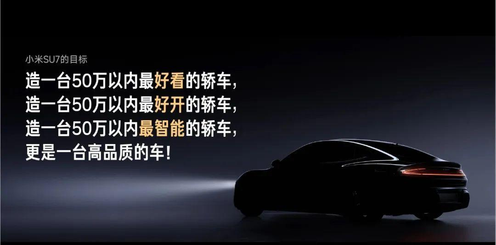

# L011 左上平行句群与右下低照度主体

源版本：46 · 家族：F02 · 类型：reference · 条目版本：1

## 结构特征

左上小标签与四行左齐主张构成文字块，前三行少量暖色关键词保持同级；低照度横向主体压在右下，轮廓光与地面光带连接左右，顶部及右上留黑。

## 构图关系

原截图1080×534，约2.02:1，非21:9。画面上部约15%为连续黑带；小标签约位于(0.05,0.23)，四行主张约占x=0.05–0.49、y=0.29–0.66；横向主体约占x=0.47–0.95、y=0.57–0.91。文字先读、视线下移至右下主体；主体上缘高光与尾部亮点界定轮廓，地面水平光带形成次级联系。比例来自截图目测，未读取可编辑对象。

## 适用内容

产品发布的愿景陈述、少量同级承诺加一句综合结论、无需精读产品细节的悬念过渡。适合一张单主体且有足够暗部文字区的宽幅照片。

## 输入条件

一张横向单主体照片或经授权的独立主体素材；主体朝向、边缘和接地关系可辨；上左有连续暗色安全区；一个短标签、约四行短主张且每行可完整断句，强调词数量克制。这里只记录源页组织方式，不保证固定字数容量；来源PPT页码、字体、图层及授权范围未知。

## 适配规则

先按当前内容确定并行句与综合句的语义，再分配左文右下主体。迁移到21:9时重新排版，保持图片等比并检查轮廓、车轮及接地完整；必要时缩放主体或补独立暗色阅读区，不能横向拉伸、机械裁切或虚构照片证据。若当前材料需要清晰展示细节，则改选清晰对象页。截图仅作参考，文字需要原生重建，尚无可编辑重建或适配验证。

## 不适用情况

多段论证、密集参数、长表格、多主体竞争或必须观察精细形态的内容。不可用压黑隐藏证据缺失；不可仅因换车、换器物、改强调色或镜像就另算新骨架；不继承参考中的产品承诺作为事实。

## 邻页安排

本页属于F02全幅图像家族，最接近L006的暗主体与左侧字组；横向主体低置和紧凑平行句群是可记录差异，不足以直接认定新家族。与L002共享全幅背景但不以场景纵深为主要任务。适配后还需审核邻页节奏。

## 搭配建议

{
  "before": "可由L010的中轴短结论或L001的偏置概念页引出愿景，使图像承担首次揭示；应按内容关系选择，不固定编号顺序。",
  "after": "可接L008的同口径对照或L007的有来源数据，分别证明主张；也可切为单一细节观察页。不要把参考文案中的承诺直接作为证据。",
  "avoid": "避免与L006或同样左文右物、低照度全幅图连续堆叠；与L002相邻时检查是否确有从现场到产品的内容推进。"
}

## 结构字段

{
  "skeleton": "fullbleed",
  "alignment": [
    "top-left",
    "bottom-right"
  ],
  "reading": [
    "title-to-image",
    "left-to-right",
    "top-to-bottom"
  ],
  "whitespace": [
    "photo-negative-space",
    "peripheral-open"
  ],
  "relations": [
    "text-in-photo",
    "contour-space",
    "type-hierarchy"
  ],
  "regions": [
    {
      "kind": "image",
      "rect": [
        0,
        0.146,
        0.998,
        0.843
      ]
    },
    {
      "kind": "text",
      "rect": [
        0.05,
        0.225,
        0.135,
        0.043
      ]
    },
    {
      "kind": "text",
      "rect": [
        0.05,
        0.291,
        0.437,
        0.078
      ]
    },
    {
      "kind": "text",
      "rect": [
        0.05,
        0.387,
        0.437,
        0.078
      ]
    },
    {
      "kind": "text",
      "rect": [
        0.05,
        0.486,
        0.437,
        0.077
      ]
    },
    {
      "kind": "text",
      "rect": [
        0.05,
        0.582,
        0.304,
        0.077
      ]
    }
  ],
  "basis": "实际查看1080×534采集截图及L006、L002、L005预览后目测；分区和归一化框均为截图估计，非源PPT对象框或字形实测。照片中的主体位于右下；未取得原始可编辑页。"
}

## 选版提示词

当页面目的是用少量平行短句陈述愿景，且当前素材具备右下横向主体、清晰轮廓和上左安全文字区时，可列为F02参考候选；必须看当前原图并与L006比较。需要参数精读、长文或细节证据时排除。截图约2.02:1，21:9适配未经验证。

## 制作提示词

输入：{页面目的}、{当前标题/标签}、{当前主张及其依据}、{图片与来源/授权}、{目标画幅}、{前后页情况}。先审查主张真实性与素材条件，再在上左安排短标签和左齐的平行句群，少量同级关键词使用一种强调色；综合句沿同一左轴收束。把单一横向主体置于右下，保留可信轮廓高光、接地阴影及安全间距，光带只作现有画面联系，不伪造证据。根据实际字形、句长和图片确定字号、行距与占幅，长句需改写或换版，不能为套图缩成难读小字。目标为21:9时等比处理图片并重新分配留白，不能直接拉伸这张约2.02:1截图。PPT中的标签、主张及必要图形均为原生可编辑对象，不把整张截图当最终页，不复制参考中的品牌、文案或产品承诺。完成后渲染本页和邻页，检查字形与主体是否遮挡、暗部轮廓可见性、文字实际背景对比、边缘裁切、阅读顺序及与L006等近似骨架的连续重复；不满足则改选布局。状态仅为构图参考，提示词与21:9适配均待真实制作验证。

## 来源

来源网页：https://zhuanlan.zhihu.com/p/690546229
页面标题：(13 封私信 / 32 条消息) 小米汽车发布会101页PPT（附下载） - 知乎
采集方式：image
图片地址：https://pica.zhimg.com/v2-ee19e43d400a0541475c71c629492b12_1440w.jpg
采集时间：2026-10-16T03:10:35.112Z
原图像素：1080×534
来源仅按采集器元数据保存；未独立核验原作者、原PPT页码、字体与素材授权。
查重备注：与另一待收录cap_ba26babe495826c0e6ccd2f403ac867c9f03e0813fb216cf1e31d9f944b132ef的SHA-256完全一致；两图已实际查看，未发现视觉或结构差异。对方任务另有有效租约，本任务只处理当前领取项，不合并、不覆盖对方记录。

## 验证状态

结构指令已编写，尚未用新内容试排验证

## 原件可用性

{
  "availability": "not-provided",
  "requires_auth": false,
  "animated": false,
  "public_url": null
}

构图参考不等于可编辑模板；换图换字后须重新适配。反例不参与选版。
