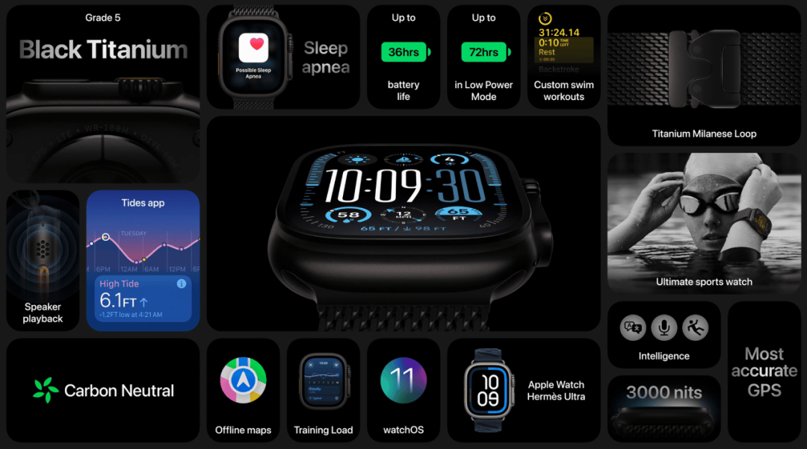

# L022 深底中央主卡与暗色功能网格（搜狐807753859·图19）

源版本：46 · 家族：候选·主从卡片矩阵 · 类型：reference · 条目版本：1

## 结构特征

中央深色产品大卡周围排列不等宽功能卡，绿色读数与小面积彩色图标形成次级焦点；卡间深灰沟槽分区。

## 构图关系

中央深色产品大卡周围排列不等宽功能卡，绿色读数与小面积彩色图标形成次级焦点；卡间深灰沟槽分区。 对象框按截图估计；用于结构检索，不是原PPT图层或精确测量。

## 适用内容

多项功能介绍后的暗色总览；主对象亮度和轮廓足够清楚；外围信息均可独立概括，且能在目标显示尺寸下阅读。

## 输入条件

主对象亮度和轮廓足够清楚；外围信息均可独立概括，且能在目标显示尺寸下阅读。 当前截图无可编辑源对象，字体、字号和固定字数容量未知；归一化框仅为看图估计。

## 适配规则

原图约16:9（以记录像素为准），迁移到21:9必须按当前素材重新分配空间，图片等比，不拉伸或机械裁掉证据；浅底参考保留原貌，黑色/近黑成品需另行验证字色、主体轮廓和背景对比。

## 不适用情况

暗卡与黑底融为一体、照搬过暗源例、以浅深配色变化伪称新结构、同时堆积彩色重点。

## 邻页安排

与现有库按结构、轴线、阅读路径和图文关系比较，不因产品或配色不同免查重。 本批18/19/20共享中央主卡和外围不等分网格；卡片数量、局部跨度与素材差异单列。

## 搭配建议

{
  "before": "先用问题、单项细节或证据建立本页的内容前提；各功能已逐项解释后再进入汇总。",
  "after": "按内容进入关键功能细节或简洁结论，避免另一页密集网格。",
  "avoid": "避免连续采用相同骨架；镜像、换色、换产品、静态改动画均须说明实际差异，不能当完全不同构图。"
}

## 结构字段

{
  "skeleton": "hero-card-grid",
  "alignment": [
    "grid",
    "shared-gutters"
  ],
  "reading": [
    "hero-to-periphery",
    "group-scan"
  ],
  "whitespace": [
    "gutter-network"
  ],
  "relations": [
    "hero-card",
    "unequal-modules",
    "consistent-gutters"
  ],
  "regions": [
    {
      "kind": "image",
      "rect": [
        0.25,
        0.26,
        0.5,
        0.49
      ]
    },
    {
      "kind": "shape",
      "rect": [
        0.01,
        0.01,
        0.24,
        0.4
      ]
    },
    {
      "kind": "shape",
      "rect": [
        0.25,
        0.01,
        0.2,
        0.23
      ]
    },
    {
      "kind": "shape",
      "rect": [
        0.45,
        0.01,
        0.1,
        0.23
      ]
    },
    {
      "kind": "shape",
      "rect": [
        0.55,
        0.01,
        0.1,
        0.23
      ]
    },
    {
      "kind": "shape",
      "rect": [
        0.65,
        0.01,
        0.1,
        0.23
      ]
    },
    {
      "kind": "shape",
      "rect": [
        0.75,
        0.01,
        0.24,
        0.32
      ]
    },
    {
      "kind": "shape",
      "rect": [
        0.75,
        0.34,
        0.24,
        0.38
      ]
    },
    {
      "kind": "shape",
      "rect": [
        0.01,
        0.76,
        0.98,
        0.23
      ]
    }
  ],
  "basis": "实际查看原文图19，归一化分区为目测估计，不含水印/字幕；主体区域不是重复计算的第二张照片。"
}

## 选版提示词

页面任务为“多项功能介绍后的暗色总览”且满足“主对象亮度和轮廓足够清楚；外围信息均可独立概括，且能在目标显示尺寸下阅读。”时查看本条预览；暗卡与黑底融为一体、照搬过暗源例、以浅深配色变化伪称新结构、同时堆积彩色重点。 条件不足时换版。

## 制作提示词

输入：{页面目的}、{当前标题/文字/数据及来源}、{图片及使用条件}、{目标画幅与风格}、{必须保留的证据}、{前后页}。
构图核心：沿主从卡片网格保持最大主对象和外围分组，以可见分隔和局部明暗分清边界；对过暗文字和图片主动重排/换素材。
适配：原图约16:9（以记录像素为准），迁移到21:9必须按当前素材重新分配空间，图片等比，不拉伸或机械裁掉证据；浅底参考保留原貌，黑色/近黑成品需另行验证字色、主体轮廓和背景对比。
边界：暗卡与黑底融为一体、照搬过暗源例、以浅深配色变化伪称新结构、同时堆积彩色重点。 条件不满足则重排或改选，不勉强套图。
可编辑要求：标题、说明、标注、必要图表和结构图在PPT中使用原生可编辑对象，图片独立放置；整张截图仅作参考，不作为最终整页。装饰光影可用独立透明图像或效果，不能压平必要文字。
审核：渲染本页与邻页，检查文字实际对比、溢出、主体与证据裁切、阅读路径、同尺度/同口径关系及连续骨架重复；未经真实重建与适配审核，不升级为模板。

## 来源

搜狐《苹果又开发布会，这PPT绝了！【PPT附下载】》，页面标注2024-09-10 13:21，账号“站在巨人的肩膀上”，正文自署“利兄”。2026-10-16完整读取正文并下载24个内嵌媒体；不把转载账号当原发布会制作署名。 本条为正文第19个内嵌媒体，分类：卡片汇总；原始地址：https://q6.itc.cn/q_70/images03/20240910/81611a9b0c12449aab4f17c677217a70.png；原图1080×602，SHA-256：55c1c6bcfc06b03885645d4958cc75f3e5e1aeb3a88728e4643b7f5e767bb069。 原PNG将随待收录记录保存，未经换图、改字、裁切或重绘。 仅作为构图/表现参考，不认证模板；品牌、产品数值及医学相关证言均为原例内容，不作为当前任务的事实依据。

## 验证状态

结构指令已编写，尚未用新内容试排验证

构图参考不等于可编辑模板；换图换字后须重新适配。反例不参与选版。
