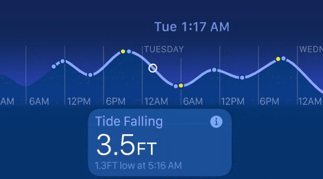

# L027 时间曲线与当前节点动态聚焦（搜狐807753859·图14）

源版本：45 · 家族：候选·时间曲线聚焦 · 类型：reference · 条目版本：1

## 结构特征

横向曲线穿过中部，时间和当前节点沿曲线推进，下方浮动读数卡与选中节点同步；背景昼夜变化。

## 构图关系

横向曲线穿过中部，时间和当前节点沿曲线推进，下方浮动读数卡与选中节点同步；背景昼夜变化。 动态观察：曲线随时间横向移动，选中点与下方读数同步变化；背景由白昼转为夜间再变亮。 对象框按截图估计；用于结构检索，不是原PPT图层或精确测量。

## 适用内容

随时间变化的测量读数或过程状态；有顺序的时间序列、明确单位和选中点；动画变化由数据/状态驱动。

## 输入条件

有顺序的时间序列、明确单位和选中点；动画变化由数据/状态驱动。 当前截图无可编辑源对象，字体、字号和固定字数容量未知；归一化框仅为看图估计。

## 适配规则

原图约16:9（以记录像素为准），迁移到21:9必须按当前素材重新分配空间，图片等比，不拉伸或机械裁掉证据；浅底参考保留原貌，黑色/近黑成品需另行验证字色、主体轮廓和背景对比。动画另做终态与减少动画版本，源GIF仅供行为观察。

## 不适用情况

把截图曲线当可精确复用数据，随机装饰线冒充测量结果，卡片与节点不同步。

## 邻页安排

与现有库按结构、轴线、阅读路径和图文关系比较，不因产品或配色不同免查重。

## 搭配建议

{
  "before": "先用问题、单项细节或证据建立本页的内容前提；根据真实内容衔接，不固定轮换编号。",
  "after": "按内容进入可核验的解释、对照或简洁结论；视觉揭示之后补足信息。",
  "avoid": "避免连续采用相同骨架；镜像、换色、换产品、静态改动画均须说明实际差异，不能当完全不同构图。"
}

## 结构字段

{
  "skeleton": "timeline-focus",
  "alignment": [
    "horizontal",
    "center"
  ],
  "reading": [
    "left-to-right",
    "point-to-detail"
  ],
  "whitespace": [
    "around-curve"
  ],
  "relations": [
    "time-series",
    "synchronized-detail"
  ],
  "regions": [
    {
      "kind": "chart",
      "rect": [
        0,
        0.25,
        1,
        0.35
      ]
    },
    {
      "kind": "text",
      "rect": [
        0.46,
        0.08,
        0.25,
        0.09
      ]
    },
    {
      "kind": "shape",
      "rect": [
        0.27,
        0.57,
        0.46,
        0.38
      ]
    },
    {
      "kind": "text",
      "rect": [
        0.3,
        0.6,
        0.38,
        0.28
      ]
    }
  ],
  "basis": "实际查看原文图14及5个时点的GIF帧，归一化分区为目测估计，不含水印/字幕；主体区域不是重复计算的第二张照片。"
}

## 选版提示词

页面任务为“随时间变化的测量读数或过程状态”且满足“有顺序的时间序列、明确单位和选中点；动画变化由数据/状态驱动。”时查看本条预览；把截图曲线当可精确复用数据，随机装饰线冒充测量结果，卡片与节点不同步。 条件不足时换版。

## 制作提示词

输入：{页面目的}、{当前标题/文字/数据及来源}、{图片及使用条件}、{目标画幅与风格}、{必须保留的证据}、{前后页}。
构图核心：将曲线、选中点、时间和读数一一绑定；移动焦点时同步改变读数，用静态终态保留可读信息，提供无动画替代。
适配：原图约16:9（以记录像素为准），迁移到21:9必须按当前素材重新分配空间，图片等比，不拉伸或机械裁掉证据；浅底参考保留原貌，黑色/近黑成品需另行验证字色、主体轮廓和背景对比。动画另做终态与减少动画版本，源GIF仅供行为观察。
边界：把截图曲线当可精确复用数据，随机装饰线冒充测量结果，卡片与节点不同步。 条件不满足则重排或改选，不勉强套图。
可编辑要求：标题、说明、标注、必要图表和结构图在PPT中使用原生可编辑对象，图片独立放置；整张截图仅作参考，不作为最终整页。装饰光影可用独立透明图像或效果，不能压平必要文字。
审核：渲染本页与邻页，检查文字实际对比、溢出、主体与证据裁切、阅读路径、同尺度/同口径关系及连续骨架重复；未经真实重建与适配审核，不升级为模板。
动态观察：曲线随时间横向移动，选中点与下方读数同步变化；背景由白昼转为夜间再变亮。 该记录不是源PPT参数。制作时按当前内容设定轨迹与时长，终态须可读，支持关闭动画；导出后播放核验。

## 来源

搜狐《苹果又开发布会，这PPT绝了！【PPT附下载】》，页面标注2024-09-10 13:21，账号“站在巨人的肩膀上”，正文自署“利兄”。2026-10-16完整读取正文并下载24个内嵌媒体；不把转载账号当原发布会制作署名。 本条为正文第14个内嵌媒体，分类：动画；原始地址：https://q9.itc.cn/q_70/images03/20240910/f4f5d8dd7df44d3481ce68be7bcf9921.gif；原图640×355，SHA-256：70868e20efa090ce119b0cc455a6c4f563e8bbefd6c823e5fb8d8c9211541f27。 GIF共55帧，时长3.84秒；已实际抽看0%、25%、50%、75%、99%时间点。预览为单帧，不能据此声称已验证PPT动画。原GIF持久副本：https://chatgpt.com/api/library/files/libfile_3d7cb02cb72081918f595584f4a12195/download。观察到：曲线随时间横向移动，选中点与下方读数同步变化；背景由白昼转为夜间再变亮。。原生动画参数、轨迹、缓动曲线和源PPT未知；截取片段不代表完整动画或可用阅读时长。 仅作为构图/表现参考，不认证模板；品牌、产品数值及医学相关证言均为原例内容，不作为当前任务的事实依据。

## 验证状态

结构指令已编写，尚未用新内容试排验证

构图参考不等于可编辑模板；换图换字后须重新适配。反例不参与选版。
