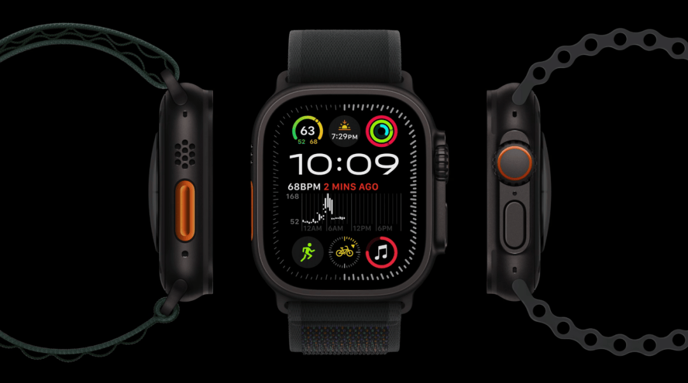

# L031 正视居中与两侧侧视并列（搜狐807753859·图07）

源版本：44 · 家族：候选·多视角并列 · 类型：reference · 条目版本：1

## 结构特征

正视主体居中，两侧侧面视图展开，三个角度处于相近垂直轴；黑底让高光与彩色细节突出。

## 构图关系

正视主体居中，两侧侧面视图展开，三个角度处于相近垂直轴；黑底让高光与彩色细节突出。 对象框按截图估计；用于结构检索，不是原PPT图层或精确测量。

## 适用内容

同一对象的多个角度或结构关系；来自同一对象的匹配视图；尺度、视角和标记关系可核对。

## 输入条件

来自同一对象的匹配视图；尺度、视角和标记关系可核对。 当前截图无可编辑源对象，字体、字号和固定字数容量未知；归一化框仅为看图估计。

## 适配规则

原图约16:9（以记录像素为准），迁移到21:9必须按当前素材重新分配空间，图片等比，不拉伸或机械裁掉证据；浅底参考保留原貌，黑色/近黑成品需另行验证字色、主体轮廓和背景对比。

## 不适用情况

把不同型号拼成同一物体、按不同倍率暗示尺寸关系，或在多个视图中重复堆长说明。

## 邻页安排

与现有库按结构、轴线、阅读路径和图文关系比较，不因产品或配色不同免查重。

## 搭配建议

{
  "before": "先用问题、单项细节或证据建立本页的内容前提；根据真实内容衔接，不固定轮换编号。",
  "after": "按内容进入可核验的解释、对照或简洁结论；视觉揭示之后补足信息。",
  "avoid": "避免连续采用相同骨架；镜像、换色、换产品、静态改动画均须说明实际差异，不能当完全不同构图。"
}

## 结构字段

{
  "skeleton": "multi-view-row",
  "alignment": [
    "center",
    "horizontal"
  ],
  "reading": [
    "center-to-sides"
  ],
  "whitespace": [
    "between-objects"
  ],
  "relations": [
    "same-object-multiple-views",
    "hero-flanked"
  ],
  "regions": [
    {
      "kind": "image",
      "rect": [
        0,
        0.04,
        0.34,
        0.92
      ]
    },
    {
      "kind": "image",
      "rect": [
        0.37,
        0.07,
        0.26,
        0.87
      ]
    },
    {
      "kind": "image",
      "rect": [
        0.69,
        0.05,
        0.31,
        0.91
      ]
    }
  ],
  "basis": "实际查看原文图07，归一化分区为目测估计，不含水印/字幕；主体区域不是重复计算的第二张照片。"
}

## 选版提示词

页面任务为“同一对象的多个角度或结构关系”且满足“来自同一对象的匹配视图；尺度、视角和标记关系可核对。”时查看本条预览；把不同型号拼成同一物体、按不同倍率暗示尺寸关系，或在多个视图中重复堆长说明。 条件不足时换版。

## 制作提示词

输入：{页面目的}、{当前标题/文字/数据及来源}、{图片及使用条件}、{目标画幅与风格}、{必须保留的证据}、{前后页}。
构图核心：中央主视图承担识别，两侧视图补充结构；用一致的缩放依据和垂直对齐关系维持可信度。
适配：原图约16:9（以记录像素为准），迁移到21:9必须按当前素材重新分配空间，图片等比，不拉伸或机械裁掉证据；浅底参考保留原貌，黑色/近黑成品需另行验证字色、主体轮廓和背景对比。
边界：把不同型号拼成同一物体、按不同倍率暗示尺寸关系，或在多个视图中重复堆长说明。 条件不满足则重排或改选，不勉强套图。
可编辑要求：标题、说明、标注、必要图表和结构图在PPT中使用原生可编辑对象，图片独立放置；整张截图仅作参考，不作为最终整页。装饰光影可用独立透明图像或效果，不能压平必要文字。
审核：渲染本页与邻页，检查文字实际对比、溢出、主体与证据裁切、阅读路径、同尺度/同口径关系及连续骨架重复；未经真实重建与适配审核，不升级为模板。

## 来源

搜狐《苹果又开发布会，这PPT绝了！【PPT附下载】》，页面标注2024-09-10 13:21，账号“站在巨人的肩膀上”，正文自署“利兄”。2026-10-16完整读取正文并下载24个内嵌媒体；不把转载账号当原发布会制作署名。 本条为正文第7个内嵌媒体，分类：产品细节放大；原始地址：https://q9.itc.cn/q_70/images03/20240910/cc4e217ee32542a49e424a9df70df4f3.png；原图1080×602，SHA-256：10d287d9002552d18836f9521d6d95e20a162fe16fc5741af98da633346d982d。 原PNG将随待收录记录保存，未经换图、改字、裁切或重绘。 仅作为构图/表现参考，不认证模板；品牌、产品数值及医学相关证言均为原例内容，不作为当前任务的事实依据。

## 验证状态

结构指令已编写，尚未用新内容试排验证

构图参考不等于可编辑模板；换图换字后须重新适配。反例不参与选版。
