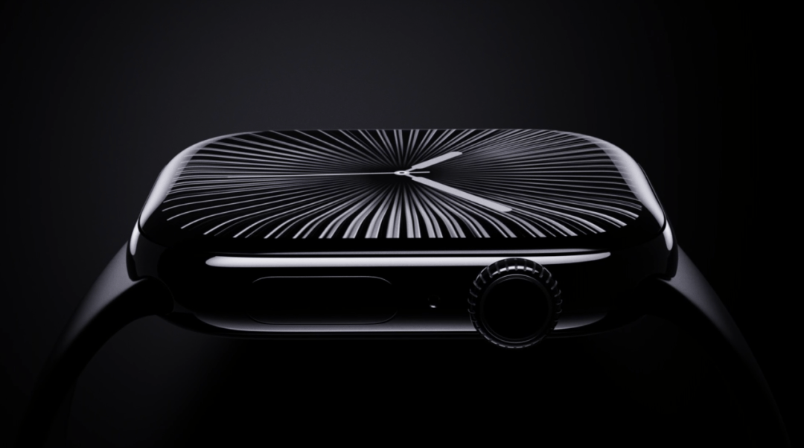

# L033 低机位放大主体与上方留黑（搜狐807753859·图05）

源版本：47 · 家族：F02 · 类型：reference · 条目版本：1

## 结构特征

低机位产品近景从下缘出血，表面放射细节与侧缘高光成为中心；上部大片黑场，无正文。

## 构图关系

低机位产品近景从下缘出血，表面放射细节与侧缘高光成为中心；上部大片黑场，无正文。 对象框按截图估计；用于结构检索，不是原PPT图层或精确测量。

## 适用内容

展示一个物体的表面、厚度或材质细节；高清近景或可控产品渲染；局部裁切仍能解释观察对象，必要轮廓可见。

## 输入条件

高清近景或可控产品渲染；局部裁切仍能解释观察对象，必要轮廓可见。 当前截图无可编辑源对象，字体、字号和固定字数容量未知；归一化框仅为看图估计。

## 适配规则

原图约16:9（以记录像素为准），迁移到21:9必须按当前素材重新分配空间，图片等比，不拉伸或机械裁掉证据；浅底参考保留原貌，黑色/近黑成品需另行验证字色、主体轮廓和背景对比。

## 不适用情况

必须完整识别的文物、必须精读的屏幕、以过暗画面隐藏结构，或把局部特写误标为完整视图。

## 邻页安排

与现有库按结构、轴线、阅读路径和图文关系比较，不因产品或配色不同免查重。

## 搭配建议

{
  "before": "先用问题、单项细节或证据建立本页的内容前提；根据真实内容衔接，不固定轮换编号。",
  "after": "按内容进入可核验的解释、对照或简洁结论；视觉揭示之后补足信息。",
  "avoid": "避免连续采用相同骨架；镜像、换色、换产品、静态改动画均须说明实际差异，不能当完全不同构图。"
}

## 结构字段

{
  "skeleton": "fullbleed",
  "alignment": [
    "center",
    "bottom"
  ],
  "reading": [
    "center-focus",
    "top-to-bottom"
  ],
  "whitespace": [
    "upper-open",
    "photo-negative-space"
  ],
  "relations": [
    "contour-space",
    "detail-crop"
  ],
  "regions": [
    {
      "kind": "image",
      "rect": [
        0,
        0,
        1,
        1
      ]
    },
    {
      "kind": "shape",
      "rect": [
        0.06,
        0.29,
        0.88,
        0.7
      ]
    }
  ],
  "basis": "实际查看原文图05，归一化分区为目测估计，不含水印/字幕；主体区域不是重复计算的第二张照片。"
}

## 选版提示词

页面任务为“展示一个物体的表面、厚度或材质细节”且满足“高清近景或可控产品渲染；局部裁切仍能解释观察对象，必要轮廓可见。”时查看本条预览；必须完整识别的文物、必须精读的屏幕、以过暗画面隐藏结构，或把局部特写误标为完整视图。 条件不足时换版。

## 制作提示词

输入：{页面目的}、{当前标题/文字/数据及来源}、{图片及使用条件}、{目标画幅与风格}、{必须保留的证据}、{前后页}。
构图核心：让主体从下方进入，保留上方静区，沿表面细节和轮廓光组织视线；不为放大而拉伸或丢失必要证据。
适配：原图约16:9（以记录像素为准），迁移到21:9必须按当前素材重新分配空间，图片等比，不拉伸或机械裁掉证据；浅底参考保留原貌，黑色/近黑成品需另行验证字色、主体轮廓和背景对比。
边界：必须完整识别的文物、必须精读的屏幕、以过暗画面隐藏结构，或把局部特写误标为完整视图。 条件不满足则重排或改选，不勉强套图。
可编辑要求：标题、说明、标注、必要图表和结构图在PPT中使用原生可编辑对象，图片独立放置；整张截图仅作参考，不作为最终整页。装饰光影可用独立透明图像或效果，不能压平必要文字。
审核：渲染本页与邻页，检查文字实际对比、溢出、主体与证据裁切、阅读路径、同尺度/同口径关系及连续骨架重复；未经真实重建与适配审核，不升级为模板。

## 来源

搜狐《苹果又开发布会，这PPT绝了！【PPT附下载】》，页面标注2024-09-10 13:21，账号“站在巨人的肩膀上”，正文自署“利兄”。2026-10-16完整读取正文并下载24个内嵌媒体；不把转载账号当原发布会制作署名。 本条为正文第5个内嵌媒体，分类：产品细节放大；原始地址：https://q5.itc.cn/q_70/images03/20240910/0c8a68365c2546a088b22e0d35605ffe.png；原图1080×602，SHA-256：ee1e085baa3f1f88b70e6b08a40679240850301866cf2750264caa34e29e680b。 原PNG将随待收录记录保存，未经换图、改字、裁切或重绘。 仅作为构图/表现参考，不认证模板；品牌、产品数值及医学相关证言均为原例内容，不作为当前任务的事实依据。

## 验证状态

结构指令已编写，尚未用新内容试排验证

## 原件可用性

{
  "availability": "external-source-unverified",
  "requires_auth": false,
  "animated": false,
  "public_url": null
}

构图参考不等于可编辑模板；换图换字后须重新适配。反例不参与选版。
